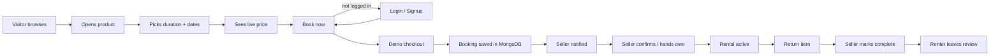
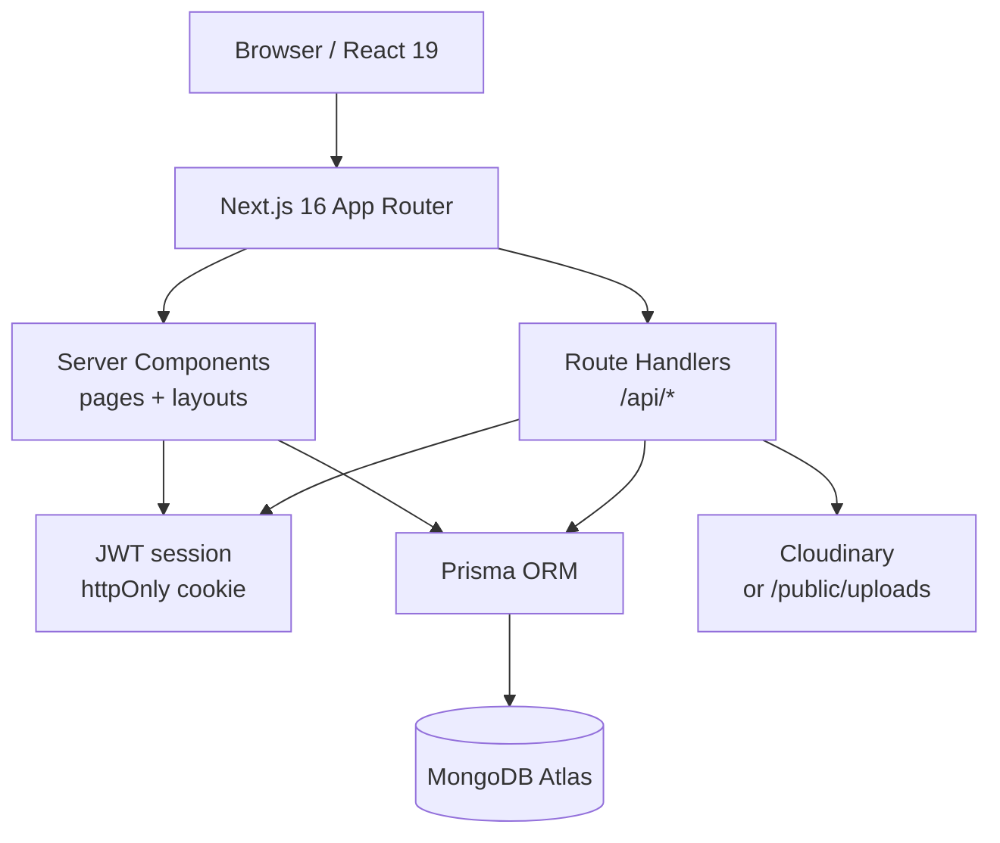

# KirayePe — Product & Usage Guide

A plain-English guide to what KirayePe is, what it does, how it works under the hood, and how to use every part of it.

> For installation, environment variables and deployment, see **[TEAM_SETUP.md](./TEAM_SETUP.md)**.

---

## 1. What is KirayePe?

KirayePe is a **peer-to-peer rental marketplace**. Instead of buying an expensive item you only need for a short time, you rent it from someone nearby. Instead of letting your own gear sit unused, you list it and earn.

The name combines *Kiraya* (rent) with *Pe* (on) — "on rent".

**One-line pitch:** *Don't buy it. Rent it.*

Built as a college project with a real database, real authentication, real bookings and a real admin console — not static screens.

---

## 2. The problem it solves

| Buying | Renting with KirayePe |
| --- | --- |
| A ₹1,80,000 camera used twice a year | ₹1,499/day, only when you need it |
| A PS5 for a two-week holiday | ₹549/day instead of ₹50,000 |
| Furniture for a 6-month internship | Monthly rental, no resale headache |
| Storage space for idle gear | List it, earn from it |

The marketplace creates value on both sides: renters save money and sellers monetise unused possessions.

---

## 3. Who uses it

| Role | What they can do |
| --- | --- |
| **Visitor** | Browse, search and filter products, view details and prices |
| **Customer / Renter** | Sign up, book products, wishlist, chat with owners, review rentals, manage profile |
| **Seller** | Everything a customer can do, plus list products, set pricing, manage incoming bookings and earnings |
| **Admin** | Moderate listings, manage users, manage bookings, view platform analytics |

Every signed-up user can be both a renter and a seller — the same account has both capabilities.

---

## 4. What the app does

### Public marketplace
- **Homepage** — hero, live search, 10 categories, featured products, recently added, popular products, how-it-works, seller CTA, trust section.
- **Explore page** — search by keyword, filter by category, city, condition and daily price, sort by newest/popular/price, paginate.
- **Product page** — image gallery, full description, condition, owner profile, ratings, all five price tiers, availability, live price calculator, booking, chat, reviews, similar products.
- **Authentication** — signup, login, logout with secure cookies.

### Renting
- Choose a duration: **daily, weekly, monthly, 6 months or yearly**.
- Pick start and return dates. The price recalculates instantly.
- See rental amount, 5% platform fee, refundable security deposit and total.
- Complete a **clearly-labelled demo checkout** (UPI / card / net banking selection, no real payment).
- Track the booking, cancel before pickup, review after completion.

### Selling
- List a product with title, description, category, brand, condition, up to 6 photos, five package prices, extra-day price, deposit, location and availability.
- Upload photos (Cloudinary in production, local folder in development), reorder cover, delete.
- Every new or edited listing goes to **pending admin review** before appearing publicly.
- See views, bookings and earnings; confirm, complete or cancel incoming bookings.

### Messaging
- Start a conversation from any product page ("Chat with seller").
- Conversations are tied to a product so both sides know what is being discussed.
- Full history with timestamps, unread badges and notifications.

### Admin
- KPIs: users, products, bookings, active rentals, demo GMV.
- Charts: 6-month GMV trend, category distribution, booking status breakdown.
- User management with search, suspension and account reactivation.
- Product moderation: approve, reject, feature, remove.
- Booking management with inline status changes and detail pages.

---

## 5. How a rental works, end to end



**Step by step**

1. **Discover** — the visitor searches or filters. Only `APPROVED` and available products are shown.
2. **Inspect** — the product page shows photos, owner, reviews, package prices and a calculator.
3. **Calculate** — the widget computes days, rental amount, platform fee, deposit and total on the client; the server recalculates everything again at checkout so the client cannot tamper with prices.
4. **Authenticate** — booking requires login. If the visitor signs in mid-flow, they are returned to the same checkout.
5. **Checkout** — the server validates dates, availability, ownership and price, then writes a `Booking` row with status `CONFIRMED` and payment status `DEMO_PAID`.
6. **Notify** — both renter and seller receive in-app notifications.
7. **Manage** — the renter sees the booking under **My rentals**. The seller sees it under **My listings → Booking requests** and can confirm or complete it.
8. **Review** — after a confirmed/active/completed rental, the renter can leave one review per product.

### Pricing rule

```
days = ceil(endDate − startDate)

Daily      → days × dailyPrice
Weekly     → full weeks × weeklyPrice + leftover days × extraDayPrice
Monthly    → full months × monthlyPrice + leftover days × extraDayPrice
6 months   → full 180-day blocks × sixMonthPrice + leftovers
Yearly     → full 365-day blocks × yearlyPrice + leftovers

platformFee = max(₹29, 5% of rental amount)
total       = rental + platformFee + securityDeposit
```

The security deposit is refundable and shown separately. All amounts are in INR and rounded.

---

## 6. How selling works

1. A logged-in user opens **Dashboard → Add product**.
2. They fill in details, upload photos, set all five package prices (with an auto-fill helper based on the daily price), deposit and location.
3. Submitting creates the product with status `PENDING`.
4. An admin reviews it under **Admin → Products → Pending review**.
   - **Approve** → status `APPROVED`, appears in search and home.
   - **Reject** → status `REJECTED`, seller is notified to edit and resubmit.
5. Live listings can be edited (which sends them back for review), marked unavailable, or deleted if they have no bookings.
6. When a customer books, the seller sees the request and can **Confirm**, **Mark complete**, or **Cancel**.

---

## 7. How chat works

- A conversation is unique per **(product, customer, seller)** triple.
- Clicking **Chat with seller** finds or creates that conversation and redirects to the inbox.
- Messages are stored in MongoDB with sender, body and timestamp.
- Unread messages are counted in the dashboard sidebar and marked read when the thread is opened.
- The recipient gets an in-app notification with a deep link to the conversation.
- The inbox fetches the selected thread from `/api/conversations/[id]/messages`.

This is intentionally simple: database-backed polling/refresh rather than WebSockets, which is sufficient for a college demo.

---

## 8. How the admin console works

| Section | Purpose |
| --- | --- |
| **Overview** | Live platform metrics and charts from MongoDB |
| **Users** | Search, filter, view activity, suspend/reactivate (admins cannot be suspended) |
| **Products** | Filter by status, approve/reject/remove, feature for the homepage |
| **Bookings** | Search, filter, update statuses, open a full payment breakdown |

Suspension immediately blocks login and invalidates the user's session on the next request. All admin APIs re-check `role === "ADMIN"` server-side.

---

## 9. How authentication & security work

- Passwords are hashed with **bcrypt** (10 rounds). Plain passwords are never stored.
- After login, the server signs a **JWT** (HS256, 7-day expiry) and stores it in an **httpOnly, SameSite=Lax** cookie.
- Every protected page calls `requireUser()` or `requireAdmin()` on the server.
- Every mutating API route re-checks the session, ownership and role — the UI is not the security boundary.
- Suspended users are treated as signed out.
- Validation is handled with **Zod** on both client forms and server handlers.
- Secrets live in `.env`, which is gitignored.

---

## 10. How it is built



| Layer | Technology |
| --- | --- |
| Framework | Next.js 16 App Router, React 19, TypeScript |
| Styling | Tailwind CSS 4, custom design tokens, Inter + Poppins |
| Database | MongoDB Atlas via Prisma ORM |
| Auth | bcrypt + jose JWT in an httpOnly cookie |
| Forms | React Hook Form + Zod |
| Images | Cloudinary, with local `public/uploads` fallback |
| Icons | Lucide React |
| Charts | Recharts |

**Server-first design:** pages are async Server Components that query Prisma directly. Client components are used only where interaction is needed (forms, chat, galleries, charts, sidebars). Mutations go through route handlers under `app/api`.

---

## 11. Database at a glance

| Model | Purpose | Key relations |
| --- | --- | --- |
| `User` | Accounts, roles, suspension | sells products, makes bookings, sends messages, owns wishlist |
| `Category` | 10 marketplace categories | has many products |
| `Product` | Listings with 5 price tiers, images, status | belongs to category + seller |
| `Booking` | Rental transaction + demo payment | product, renter, seller |
| `Conversation` | Chat thread per product/customer/seller | product + two users |
| `Message` | Individual chat message | conversation + sender |
| `Review` | Rating + comment | product + author + seller target |
| `Wishlist` | Saved products | unique per user/product |
| `Notification` | In-app alerts | user |

Collections use MongoDB ObjectIds and Prisma relations, with indexes on foreign keys, statuses, cities and dates. There are unique constraints on email, category slug, wishlist pairs and conversation triples.

---

## 12. Page map

| Route | What it is |
| --- | --- |
| `/` | Homepage |
| `/products` | Explore with filters |
| `/products/[id]` | Product details + booking |
| `/checkout/[id]` | Demo checkout |
| `/login`, `/signup` | Authentication |
| `/dashboard` | User overview |
| `/dashboard/rentals` | My bookings |
| `/dashboard/listings` | Seller listings + requests |
| `/dashboard/listings/new` | Add product |
| `/dashboard/listings/[id]/edit` | Edit product |
| `/dashboard/messages` | Inbox + chat |
| `/dashboard/wishlist` | Saved products |
| `/dashboard/profile` | Public profile editor |
| `/dashboard/settings` | Password + preferences |
| `/admin` | Admin analytics |
| `/admin/users`, `/admin/users/[id]` | User management |
| `/admin/products` | Listing moderation |
| `/admin/bookings`, `/admin/bookings/[id]` | Booking management |

---

## 13. How to use it

### As a visitor
1. Open `/`.
2. Search or click a category.
3. Use filters on `/products` and open a listing.
4. Press **Book now** — you will be asked to log in.

### As a customer (demo: `user@kirayepe.com` / `KirayePe@123`)
1. Log in with the **User** quick-fill button.
2. Open a product, choose a duration, adjust dates and review the total.
3. Book → checkout → accept the demo terms → pay (simulated).
4. **Dashboard → My rentals** shows the booking. Cancel before pickup if needed.
5. **Wishlist** saves items; **Messages** shows conversations; **Profile/Settings** manages your account.
6. After a completed rental, open the product and post a review.

### As a seller (demo: `seller@kirayepe.com` / `KirayePe@123`)
1. **Dashboard → My listings** shows your products, views, earnings and booking requests.
2. **Add product** → upload photos → auto-fill package prices → submit.
3. Wait for admin approval; then the listing appears publicly.
4. For incoming bookings use **Confirm**, **Mark complete** or **Cancel**.
5. Reply to customers in **Messages**.

### As an admin (demo: `admin@kirayepe.com` / `KirayePe@123`)
1. `/admin` shows live KPIs and charts.
2. **Products → Pending review** → approve or reject submissions.
3. **Users** → search, inspect, suspend or reactivate.
4. **Bookings** → change statuses, open a booking to see the payment breakdown.

---

## 14. Design language

- White and light-grey canvas with dark ink typography.
- **Emerald/teal accent** with cyan highlights.
- Inter for body text, Poppins for headings.
- Soft shadows, 1.5–2rem rounded corners, hover lift, gradient mesh hero.
- Premium sidebars and data-dense tables for admin.
- Fully responsive: mobile drawer navigation, stacked dashboards, scrollable tables.
- Skeleton loading states and spinner feedback on every async action.

---

## 15. What is simulated (important)

- **Payments are fake.** The checkout is labelled as a demo, no card details are collected, no gateway is called, and every booking gets a `DEMO-XXXX` reference.
- Security deposits are displayed and marked refunded on cancellation/completion but no money moves.
- Emails are not sent; all notifications are in-app.
- Notification toggles in Settings are session-only UI state.
- There is no email verification, password reset or two-factor authentication.

---

## 16. Limitations & future scope

| Current limitation | Possible next step |
| --- | --- |
| Simulated payments | Integrate Razorpay/Stripe with webhooks and payouts |
| No WebSockets | Real-time chat with Socket.IO or Pusher |
| No ID/KYC verification | Aadhaar/DigiLocker or document upload + admin review |
| No delivery logistics | Partner delivery slots and tracking |
| No dispute flow | Damage reports, deposit deduction and arbitration |
| Simple recommendations | Personalised ranking by history and location |
| No email/SMS | Transactional email and OTP notifications |
| Session-only preferences | Persist notification settings per user |

---

## 17. Quick FAQ

**Is the data real?** Yes — everything lives in MongoDB Atlas and is created through the app. The seeded users/products/bookings are demo records, but the operations on them are real.

**Can one account rent and sell?** Yes. Every non-admin user can list products and book other products.

**Why did my listing not appear?** New and edited listings are `PENDING` until an admin approves them.

**How do I reset the demo?** Run `npm run db:seed` — it wipes and recreates all demo data.

**Why can't I review a product?** Reviews require a confirmed, active or completed booking for that product, and only one review per user per product.

**What happens when an admin suspends someone?** Their JWT cookie remains, but every request resolves the user from the database and rejects suspended accounts, so they are signed out.

**Where are images stored?** Cloudinary if configured; otherwise `public/uploads` in local development. Seeded product photos are Unsplash URLs.

**Does it work on mobile?** Yes — the layout is responsive with drawer navigation for dashboard and admin.

---

## 18. Demo credentials

| Role | Email | Password |
| --- | --- | --- |
| Admin | `admin@kirayepe.com` | `KirayePe@123` |
| User | `user@kirayepe.com` | `KirayePe@123` |
| Seller | `seller@kirayepe.com` | `KirayePe@123` |

All 20 seeded accounts use the same password. The login page has quick-fill buttons for the three demo roles.

---

## 19. Related documents

- **[TEAM_SETUP.md](./TEAM_SETUP.md)** — install, environment, seed, troubleshooting, deployment.
- **[README.md](./README.md)** — technical summary, scripts and feature checklist.
